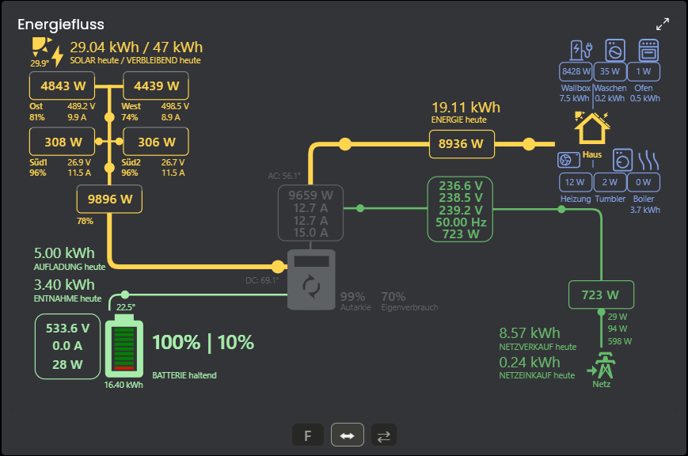
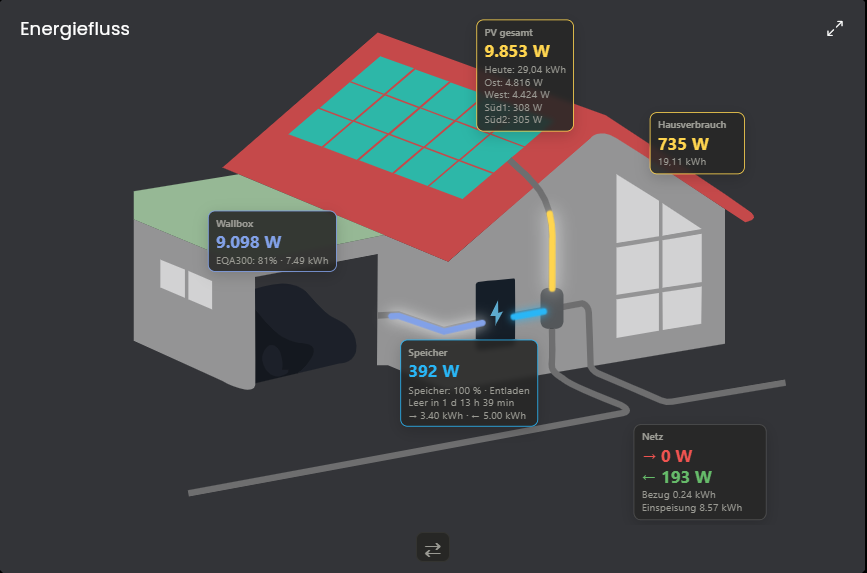
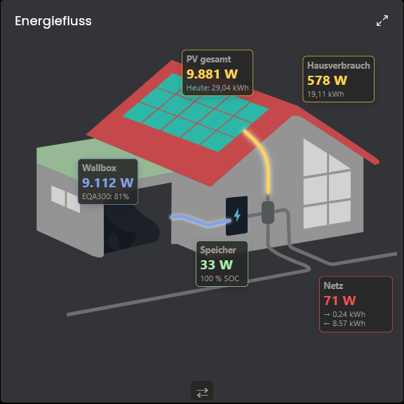

# ⚡ Energiefluss für IP-Symcon

Ein modernes Energieflussmodul für **IP-Symcon** zur Visualisierung von Energieflüssen in Echtzeit.

Das Modul kombiniert zwei vollständig integrierte Visualisierungen:

- ⚡ Technische Energieflussansicht
- 🏠 Grafische Hausansicht

Beide Ansichten können direkt innerhalb der Visualisierung umgeschaltet werden.

---

# ❤️ Verwendete Open-Source-Projekte

Dieses Modul integriert und erweitert folgende Open-Source-Projekte für die Verwendung innerhalb von **IP-Symcon**.

## Third-Party Components

| Komponente | Lizenz | Verwendung |
|------------|---------|------------|
| Sunsynk Power Flow Card | Apache License 2.0 | Technische Energieflussdarstellung |
| Power Flow Card (LordGuenni) | MIT | Hausgrafik |
| Lit (Google LLC) | BSD-3-Clause | Web Components Framework |

Die vollständigen Lizenztexte befinden sich im Verzeichnis `licenses/`.

Alle Rechte an den jeweiligen Drittkomponenten verbleiben bei deren ursprünglichen Autoren.

---

## 🏠 Power Flow Card

Projekt:

https://github.com/LordGuenni/power-flow-card

- Grundlage der Hausansicht
- Für IP-Symcon erweitert und lokal integriert
- Lizenz: MIT

---

## ⚡ Sunsynk Power Flow Card

Projekt:

https://github.com/slipx06/sunsynk-power-flow-card

- Grundlage der technischen Energieflussansicht
- Unterstützung der Ansichten Lite, Compact, Full sowie Wide
- Für IP-Symcon erweitert und lokal integriert
- Lizenz: Apache License 2.0

---

Alle benötigten Dateien werden lokal mit diesem Modul ausgeliefert.

Es werden **keine externen CDN-Dateien** oder Internetverbindungen benötigt.

---

# 📸 Screenshots

## Technische Energieflussansicht

## Hausansicht

## Hausansicht (Smartphone)

---

# ✨ Highlights

- ☀️ Bis zu 6 PV-Strings
- 🔧 Beliebig viele Wechselrichter mit Summenbildung
- 🔋 Bis zu 2 Batteriespeicher
- ⚡ Smart Meter
- 🚗 Wallbox mit Fahrzeug-SOC
- 🔌 Beliebig viele Verbraucher
- 📊 Automatische Berechnung von Hausverbrauch, Autarkie und Eigenverbrauch
- 🔮 Solarprognose
- 🌡️ AC- und DC-Temperatur des Wechselrichters
- 🎨 Frei konfigurierbare Farben
- 🎯 Frei wählbare Icons
- 📱 Optimiert für Desktop, Tablet und Smartphone
- ⚡ Dynamische Energieflussanimation
- 📐 Lite-, Compact-, Full- und Wide-Ansichten

---

# ⚙️ Konfiguration

## Allgemein

- Anzeige (Technische Ansicht / Hausgrafik)
- Layout (Lite / Compact / Full)
- Wide-Modus
- Flussgeschwindigkeit
- Farben
- Animationen

---

## ☀️ PV-Strings

Für jeden PV-String können folgende Werte konfiguriert werden:

- Name
- Leistungsvariable
- Spannung
- Strom
- Maximalleistung

Die Tages- und Gesamtenergie werden automatisch aus den Wechselrichtern übernommen.

---

## 🔧 Wechselrichter

Beliebig viele Wechselrichter können konfiguriert werden.

Pro Wechselrichter:

- Name
- Gesamtleistung
- Tagesenergie
- Gesamterzeugung
- AC-Temperatur
- DC-Temperatur
- Strom L1
- Strom L2
- Strom L3

Alle Werte werden automatisch summiert.

---

## 🔋 Batteriespeicher

Bis zu zwei Batteriespeicher.

Pro Batterie:

- Leistung
- Ladeleistung
- Entladeleistung
- Ladeenergie
- Entladeenergie
- State of Charge (SOC)
- Maximaler Entlade-SOC

---

## ⚡ Smart Meter

Konfigurierbar:

- Netzbezug
- Netzeinspeisung
- Tagesbezug
- Tageseinspeisung
- Spannung L1/L2/L3
- Strom L1/L2/L3
- Netzfrequenz

---

## 🚗 Wallbox

- Name
- Ladeleistung
- Energie
- Fahrzeug-SOC

---

## 🔌 Verbraucher

Beliebig viele Verbraucher.

Pro Verbraucher:

- Name
- Leistungsvariable
- Energie
- Icon
- Farbe

Automatische Anzeige der leistungsstärksten Verbraucher.

---

## 🎨 Darstellung

Konfigurierbar sind unter anderem:

- Farben aller Energieflüsse
- Farben der Hausgrafik
- Farben der Verbraucher
- Farben der Wallbox
- Wechselrichterfarbe
- Hausverbrauchsmodell
- Berechnung von Autarkie / Eigenverbrauch
- Flussgeschwindigkeit
- Icons
- Layout

---

# 📊 Berechnungen

Das Modul berechnet automatisch:

- Hausverbrauch
- Autarkie
- Eigenverbrauch
- Solarprognose
- Restproduktion des Tages
- Summen mehrerer Wechselrichter
- Summen mehrerer Batteriespeicher

Alle Berechnungen erfolgen vollständig innerhalb des Moduls.

---

# 📱 Responsive Design

Optimierte Darstellung für

- Desktop
- Tablet
- Smartphone

mit automatischer Skalierung der Visualisierung.

---

# 🚀 Installation

1. Repository installieren
2. Instanz **Energiefluss** erstellen
3. PV-Strings konfigurieren
4. Wechselrichter konfigurieren
5. Batteriespeicher konfigurieren
6. Smart Meter konfigurieren
7. Wallbox (optional)
8. Verbraucher hinzufügen
9. Darstellung anpassen
10. Fertig

## IPSView-App

PHP liest die unveränderten Originaldateien aus `assets/vendor/` und bettet sie zusammen mit der Darstellung als ein gzip-komprimiertes Paket in das HTML-SDK-Kachel-HTML ein. Die Browser-/WebView-Laufzeit entpackt dieses Paket mit `DecompressionStream` und lädt die JavaScript-Module über lokale Blob-URLs. Die Darstellung benötigt keinen WebHook und keine Serveradresse. Eine bestehende Symcon-Verbindung reicht somit auch bei Zugriff über Symcon Connect; die tatsächliche mobile IPSView-Laufzeit muss gzip-Dekomprimierung und Blob-Module unterstützen. Ältere Laufzeiten ohne gzip-Unterstützung zeigen eine konkrete Fehlermeldung.

Während des Starts bleibt die Darstellung bis zur fertig angepassten Card verborgen. Beim Öffnen fordert die Kachel aktuelle Messwerte und die gespeicherte App-Ansicht über das HTML-SDK an. Eine Anfragekennung ordnet die Antwort dem jeweiligen Client zu. Das zwischengespeicherte Kachel-HTML enthält keine Momentaufnahme der Messwerte; ältere oder unvollständige Nachrichten können den aktuellen Stand nicht überschreiben. Gültige Nullwerte werden weiterhin dargestellt. Beide Original-Cards bleiben unverändert und können weiterhin als Dateien ersetzt werden. Anpassungen für Symcon, einschließlich eines Ersatzspeichers bei gesperrtem `localStorage`, liegen in `module.php`. Fehlt die Symcon-Icon-Bibliothek, stehen in der App lokale SVG-Symbole für Ladesäule, Waschmaschine und Trockner bereit; andere nicht verfügbare Symbole erhalten einen Stecker als Ersatz.

Die komprimierte Kachel umfasst derzeit ungefähr 474 KB und liegt unter dem beobachteten Symcon-Output-Buffer-Limit von 1.048.576 Bytes. PHP prüft die Größe des erzeugten HTML vor der Rückgabe und meldet ab 900.000 Bytes einen verständlichen Fehler, sodass Reserve für die Übertragung bleibt. Eine spätere wesentlich größere Card-Version kann diese Grenze erreichen.

Ansicht und Techniklayout bleiben pro Modulinstanz getrennt. Im Browser werden sie weiterhin lokal gespeichert. Im App-Modus ohne Serveradresse speichert Symcon sie pro Instanz, sodass sie auch ohne `localStorage` nach dem erneuten Öffnen erhalten bleiben. Mehrere Instanzen können somit unterschiedliche Ansichten behalten; im App-Modus gilt die gespeicherte Ansicht einer Instanz für alle Clients, die diesen Modus verwenden.

Die PHP-Regressionstests für eingebettete Originaldateien, die Größenbegrenzung, frische SDK-Startdaten und gespeicherte Ansichten lassen sich mit `php tests/ipsview.php` ausführen. `node tests/ipsview-browser.cjs` prüft mit Playwright und Chromium den App-Modus ohne Browseradresse, den Browser und eine simulierte Connect-Adresse. Optional lassen sich `PHP_BINARY` und `CHROMIUM_BINARY` setzen. Die Tests verwenden einen begrenzten Symcon-Teststub und ersetzen keinen Test in der nativen IPSView-App oder über einen echten Connect-Tunnel.

---

# ❤️ Credits

Ein herzliches Dankeschön an

- LordGuenni
- slipx06
- Google LLC (Lit)

für die Veröffentlichung ihrer hervorragenden Open-Source-Projekte.

---

# 📦 Versionen

### Version 1.12 (22.09.2026)
- Paralleles laufen lassen von mehreren Instanzen und individueller Ansicht funtkioniert wieder. 
- Die Ladegeschwindigkeit der Kachel wurde verbessert.

### Version 1.11 (16.09.2026)
- Anpassungen um die IPS-View Kompatibilität zu erreichen.

### Version 1.10 (06.09.2026)
- Zusätzlicher Code wird nun über einen Webhook und nicht mehr direkt ins html geladen, um die Output Buffer Fehlermeldung zu vermeiden.

### Version 1.9 (03.09.2026)
- Codekorrekturen nach Store-Review.

### Version 1.8 (25.08.2026)
- Es wird nun intern auf ganze Watt abgerundet, um unschöne Darstellungen von zB 1W Solarproduktion in der Nacht zu vermeiden.

### Version 1.7 (24.08.2026)
- Konfiguration der Ansichten aus dem Konfigurationsformular entfernt. So kann auf jedem Gerät eine individuelle Ansicht gewählt werden. Werden pro View mehrere unterschiedliche Ansichten gewünscht, muss die Instanz geklont werden. Die Kacheln in der Visu identifizieren sich nun über die Instanz.

### Version 1.6 (15.08.2026)
- In der Hausansicht wird für die Netzleistung nur noch ein Wert dargestellt.
- In der Sunsynk-Card verhalten sich die Smartmeter-, Batterie- und Wechselrichter-Boxen nun dynamisch.
- Ein Fehler wurde behoben, durch den in der Full-Ansicht bei genau drei aktiven Verbrauchern die Verbraucher komplett ausgeblendet wurden.
- Ein Fehler wurde behoben, durch den AUX-Verbraucher in der Compact- und Large-Ansicht nicht als normale Verbraucher dargestellt wurden.
- Die Position des Schriftzuges „Energie heute“ in der Large-Ansicht wurde verbessert.
- Die Position des SOC bei zwei AUX-Verbrauchern wurde verbessert.
- Einige Codeoptimierungen und Verbesserungen für schwächere Clients.
- In der Full-Ansicht werden die AUX-Verbraucher aus dem Hausverbrauch herausgerechnet, damit die Darstellung stimmt.

### Version 1.5 (08.08.2026)
- Laufzeit der Batterie kann nun als Variable ausgegeben werden.
- In der Konfiguration die geforderten Werte klar formuliert.

### Version 1.4 (06.08.2026)
- Strom der Batterie wird ausgeblendet, wenn er nicht konfiguriert ist.
- Batteriestatus wird in Compact nun korrekt angezeigt.
- Fenster mit Batteriedaten wird in der Compact nun angezeigt.
- In der Konfiguration unglücklich beschriebener Tagesverbrauch für das Netz klar formuliert.

### Version 1.3 (05.08.2026)
- Die errechneten Variablen können unterhalb der Modulinstanz zur weiteren Verwendung erstellt werden.
- Eigenverbrauchsberechnung berücksichtigt nun auch die Batterie

### Version 1.2 (04.08.2026)
- Automatische Berechnung des Hausverbrauchs überarbeitet.
- Autarkie und Eigenverbrauch können nun selber definiert werden und die automatische Berechnung überarbeitet.
- AUX und normale Verbraucher überarbeitet, in Full werden max. 2 AUX und 2 Verbraucher oder 6 Verbraucher dargestellt.

### Version 1.1 (03.08.2026)
- Die Energiemenge (kwh) für den Hausverbrauch kann nun selber definiert werden, analog der Leistung.
- Die Energiemenge lässt sich nun analog der Leistung in drei verschiedenen Modi berechen.
- Der Status der Batterien kann nun angezeigt werden.
- Verbrauchern kann eine Mindestleistung hinterlegt werden, unter deren sie ausgeblendet werden.
- Maximal 2 Verbraucher können als AUX-Verbraucher markiert werden, damit diese prominent dargestellt werden.

### Version 1.0 (02.08.2026)
- Initiale Version

---

# 📄 Lizenz

Dieses Projekt steht unter der **MIT-Lizenz**.

Es enthält Komponenten der folgenden Open-Source-Projekte:

- Power Flow Card – MIT License
- Sunsynk Power Flow Card – Apache License 2.0
- Lit – BSD-3-Clause

Die jeweiligen Copyright- und Lizenzhinweise der Originalprojekte befinden sich im Verzeichnis `licenses/`.
